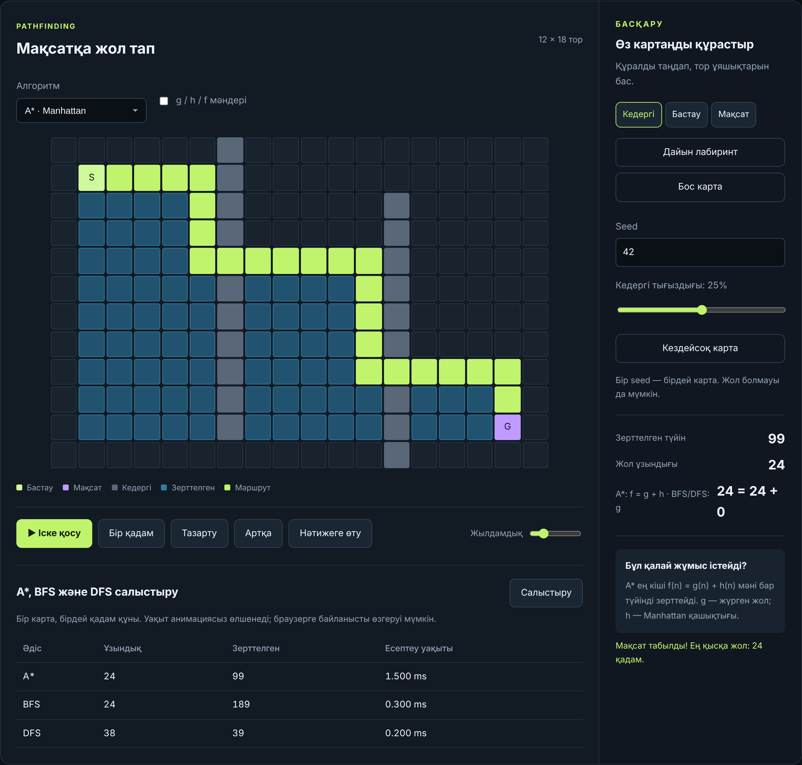
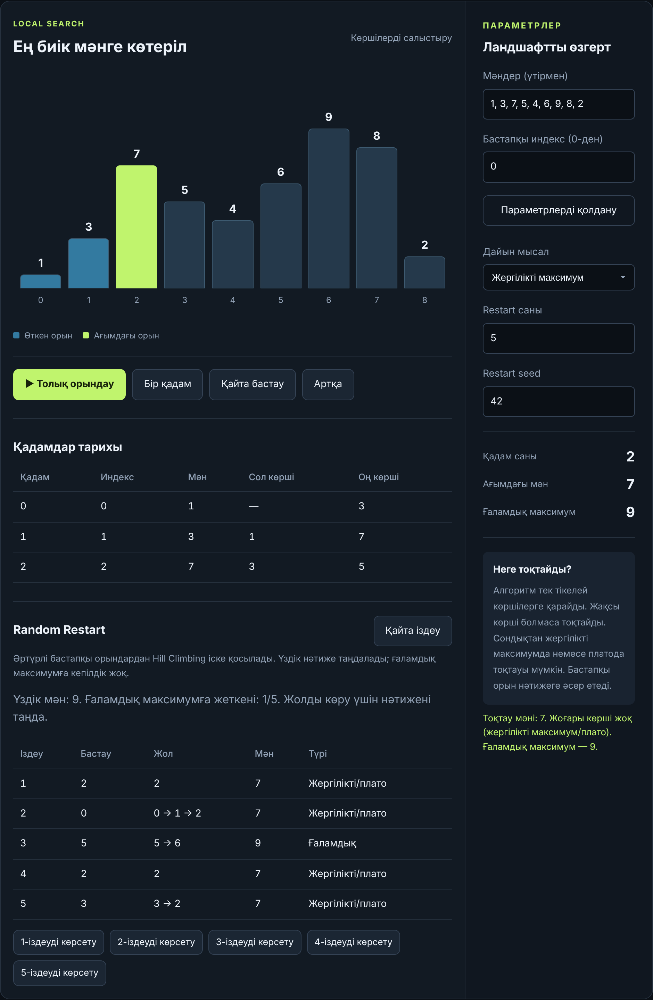
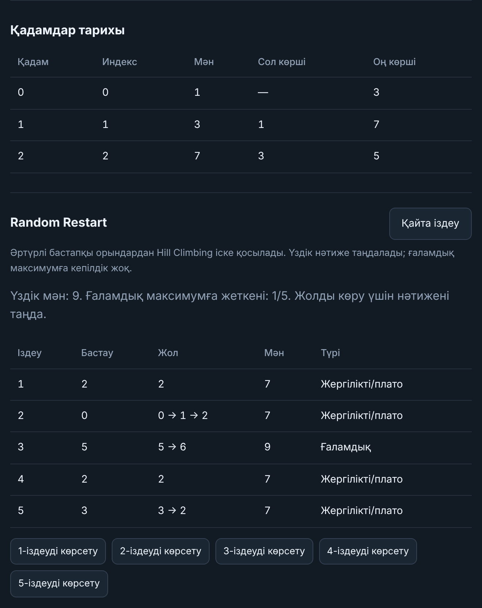
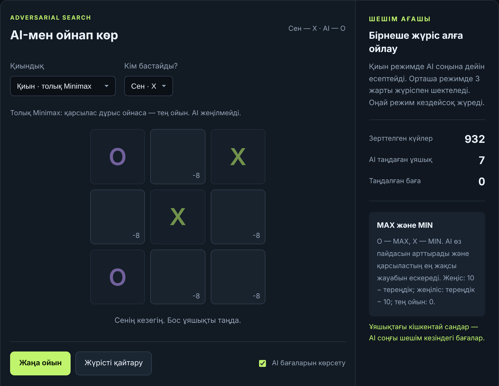
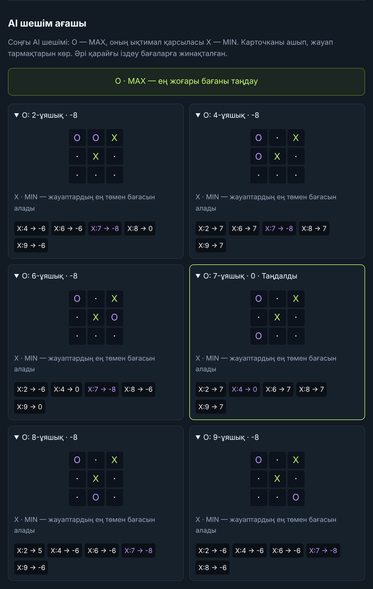

# Technical Report — AI Algorithm Visualizer
**Автор:** Zanov Zhanarys. **Пән:** AI Fundamentals. **Университет:** QAIRU. **Жыл:** 2026.

## Мақсаты
AI алгоритмдерінің шешімін интерактивті түрде көрсету. Пайдаланушы картаны, сандарды, бастапқы индексті немесе ойын жүрісін өзгертіп, нәтижеге әсерін бақылайды. Жоба арнайы дайын AI API қолданбайды; алгоритмдер JavaScript кодында іске асырылған.

## Үш түрлі апта
| Апта | Тақырып | Іске асырылуы |
|---|---|---|
| 2 | Search, A*, Heuristics | Тордағы A*, BFS және DFS іздеуі (бір тақырып) |
| 3 | Local Search | Steepest-ascent Hill Climbing |
| 4 | Adversarial Search | Толық тереңдіктегі Minimax |

## Архитектура
Интерфейс (HTML/CSS) → app.js (басқару және көрсету) → algorithms.js (есептеу) → қадамдар, нәтижелер және метрикалар. Алгоритмдер DOM-ға тәуелсіз, сондықтан Node.js ортасында жеке тексеріледі. Барлық есептеу браузерде орындалады. Жеке мәліметтер сақталмайды.

## Іске қосу нұсқаулығы
1. Жобаны жүктеп алып, ZIP мұрағатын ашыңыз.
2. `dist/index.html` файлын браузерде ашыңыз (Chrome, Edge, Firefox немесе Safari).
3. Балама тәсіл (Python 3 қажет): жобаның түбір қалтасында `python -m http.server 8000 --directory dist` командасын орындап, браузерде [http://localhost:8000](http://localhost:8000) мекенжайын ашыңыз.

Жүктеп алынған сайт интернетсіз және API кілтінсіз жұмыс істейді: барлық есептеу браузерде орындалады.

**Онлайн нұсқа:** [https://zhanarys-ai-lab-2026.zhanaryszanov712.chatgpt.site](https://zhanarys-ai-lab-2026.zhanaryszanov712.chatgpt.site) — бұл нұсқаға кіру үшін ChatGPT арқылы авторизация қажет.

**GitHub:** [https://github.com/zanovzhss/AI-Algorithm-Visualizer](https://github.com/zanovzhss/AI-Algorithm-Visualizer)

## A*
Мақсаты: кедергілері бар торда қысқа жол табу. Кіріс: тор өлшемі, кедергілер жиыны, бастау және мақсат. Шығыс: маршрут, зерттелген түйіндер реті, жол құны немесе жол жоқ нәтижесі.
Әр қадам құны — 1, қозғалыс — жоғары/оңға/төмен/солға. f(n)=g(n)+h(n). g — бастапқы нүктеден жүрген ең аз белгілі құн; h=|r−goal_r|+|c−goal_c| — Manhattan қашықтығы. Ең кіші f түйіні ашық жиыннан алынады, көршілердің құны жаңартылады. Мақсатқа жеткенде ата-аналар тізбегі арқылы жол қалпына келеді. Бұл эвристика берілген қозғалыс ережесінде consistent болғандықтан жабық түйіндерді қайта ашу қажет емес.
Метрикалар: зерттелген түйін саны, маршрут ұзындығы және ағымдағы f, g, h.
Шектеу: тор шағын; диагональ мен әртүрлі жол салмақтары жоқ. Open жиынын сұрыптау үлкен карталарға тиімсіз, ондайда priority queue қолданған дұрыс. Қадамдық көрсетілім дайын есептелген іздеу ізін көрсетеді; анимация жылдамдығы алгоритмнің нақты есептеу уақыты емес.

## Hill Climbing
Мақсаты: бастапқы орыннан жақсы көршіге ауысып, жоғары мәнге жету. Кіріс: 2–20 сан және бастапқы индекс. Шығыс: өткен индекстер, тоқтау орны, тоқтаған мәні. Тек сол және оң көрші қаралады. Ең жақсы көрші ағымдағы мәннен қатаң үлкен болса көшеміз; болмаса тоқтаймыз. Тең көршілерде кіші индекс таңдалады.
Мысал: [1,3,7,5,4,6,9,8,2]. 0-ден бастасақ: 0→1→2, мәні 7. 5-тен бастасақ: 5→6, мәні 9.
Метрикалар: ауысулар саны және табылған мән. Ғаламдық максимум салыстыру үшін массивтен бөлек есептеледі; ол Hill Climbing жүрісін таңдауға қолданылмайды.
Шектеу: жергілікті максимум мен платода тоқтайды; ғаламдық максимумға кепілдік жоқ. Бірөлшемді оқу мысалы.

## Minimax
Мақсаты: крестик-ноликте тиімді жүріс таңдау. Кіріс: тоғыз ұяшықты тақта. Шығыс: таңдалған жүріс, мүмкін жүрістер бағасы, зерттелген күйлер саны. Адам X, AI O. O — MAX, X — MIN. Терминал бағалар: O жеңісі 10−depth; X жеңісі depth−10; тең ойын 0. AI барлық жалғастарды соңына дейін қарап, MAX кезегінде максимум, MIN кезегінде минимум алады. Тереңдік тезірек жеңіске және кешірек жеңіліске басымдық береді. Тең бағалы жүрістерде кіші индекс таңдалады.
Метрикалар: зерттелген күйлер және жүріс бағалары. Ұяшықтағы бағалар — соңғы AI шешімі кезіндегі кандидаттардың бағалары; кейінгі позицияның жаңа бағалары емес.
Шектеу: толық іздеу үлкен ойындарға қымбат. Бұл нұсқада alpha-beta pruning және оқыту жоқ. Minimax — іздеу алгоритмі, нейрондық желі емес.

## Тестілеу және нәтижелер
Қазіргі нұсқаның қорытынды нәтижесі: **24 алгоритм тесті** және интерфейстің **11 DOM интеграциялық тесті** өтті.

- `node tests/algorithms.test.cjs` — 24 алгоритм тесті өтті.
- `node tests/interface.test.cjs` (алдымен `npm install --no-save jsdom`) — 11 DOM интеграциялық тесті өтті. Бұл тестілер интерфейс әрекеттерін тексереді; визуалды орналасуды растамайды.

**Тексеру мысалдары** (24 тесттің толық тізімі емес):

| Тексеру | Нәтиже |
|---|---|
| A*: бос 3×4 тор | Құны 5, 6 ұяшық |
| A*: жол толық жабық | Жол жоқ, cost=null |
| A*: бастау=мақсат | Құны 0 |
| A*: 80 детерминді кездейсоқ карта | Тәуелсіз BFS-пен жол құны бірдей, жол қадамдары жарамды |
| Hill: 0-ден бастау | Жергілікті максимум 7 |
| Hill: 5-тен бастау | Ғаламдық максимум 9 |
| Hill: плато, теріс мәндер | Ережеге сай тоқтау/көтерілу |
| Hill: NaN | Қате кіріс қабылданбайды |
| Minimax: жеңетін жүріс | Бірден жеңетін ұяшық таңдалады |
| Minimax: қарсыласқа тосқауыл | Жеңісті бөгейді |
| Minimax: бастапқы тақтаны сақтау | Кіріс массив өзгермейді |
| Minimax: адамның барлық жүріс тармақтары | 569 терминал тармағы тексерілді; адам жеңген жоқ |

Бастапқы нұсқада браузерде A* бір қадамы, Hill Climbing үшін 0 және 5 бастапқы индекстері, AI қарсы жүрісі қолмен тексерілді. Жаңартылған нұсқаның алгоритмдері автоматты тестілермен тексерілді. Кейін жаңа нұсқа браузерде іске қосылып, үш негізгі сценарийдің скриншоттары түсірілді («Скриншоттар» бөлімі). Қате сан, диапазоннан тыс индекс және бос кірістер интерфейсте өңделеді. Accuracy/F1 бұл іздеу есептеріне сәйкес емес, сондықтан қолданылмайды.

## Скриншоттар
Суреттер ZIP мұрағатындағы өзгертілмеген `dist/` нұсқасынан түсірілді: сайт `python -m http.server` арқылы іске қосылып, Chromium браузерінде 1000×900 терезеде ашылды. Суреттер өңделмеген; 3, 4 және 5-суреттер — экранның нақты бөлігінен кесіп алынған фрагменттер.

### A*, BFS және DFS салыстыру
Әрекеттер: «Дайын лабиринт» → алгоритм «A* · Manhattan» → «Нәтижеге өту» → «Салыстыру».

_Сурет 1. Дайын лабиринттегі A* нәтижесі және A*, BFS, DFS салыстыру кестесі._

- Тор 12×18: S — бастау, G — мақсат, сұр — кедергі; жасыл — A* маршруты, көк — зерттелген түйіндер. Оң жақта: зерттелген түйін — 99, жол ұзындығы — 24, f = 24 = 24 + 0 (мақсатта h = 0).
- Кесте: A* — 24 қадам, 99 түйін; BFS — 24 қадам, 189 түйін; DFS — 38 қадам, 39 түйін. A* пен BFS ең қысқа жолды тапты, ал Manhattan эвристикасының арқасында A* шамамен екі есе аз түйін зерттеді. DFS жолы 14 қадамға ұзын: DFS ең қысқа жолға кепілдік бермейді.
- «Есептеу уақыты» браузерге және оның жүктемесіне тәуелді, әр іске қосуда өзгереді; бұл мәндер алгоритмдердің жылдамдығы туралы жалпы қорытынды жасауға жеткілікті негіз емес.

### Hill Climbing және Random Restart
Әрекеттер: мәндер `1, 3, 7, 5, 4, 6, 9, 8, 2`, бастапқы индекс 0, Restart саны 5, Restart seed 42 → «Қайта іздеу» → «Толық орындау».

_Сурет 2. Hill Climbing панелі: нәтиже, параметрлер, қадамдар тарихы және Random Restart._

- Диаграммада көк бағандар — өткен орындар (0 және 1 индекс), жасыл баған — тоқтаған орын (2 индекс, мәні 7). Оң жақта: қадам саны 2, ағымдағы мән 7, ғаламдық максимум 9. Күй жолы: «Тоқтау мәні: 7. Жоғары көрші жоқ (жергілікті максимум/плато). Ғаламдық максимум — 9.»

_Сурет 3. 2-суреттің үлкейтілген бөлігі: «Қадамдар тарихы» және «Random Restart» кестелері._

- Қадамдар тарихы: индекстер 0 → 1 → 2, мәндер 1 → 3 → 7. Соңғы жолда сол көрші 3, оң көрші 5 — екеуі де 7-ден кіші, сондықтан алгоритм тоқтайды: бұл жергілікті максимум.
- Random Restart: бес іздеудің бастаулары 2, 0, 5, 2, 3. Тек 3-іздеу (5 → 6) 9 мәніне жетті, қалған төртеуі 7-де тоқтады: «Үздік мән: 9. Ғаламдық максимумға жеткені: 1/5.»
- Бастапқы орын нәтижені анықтайды. Бірнеше рет бастау ғаламдық максимумды табу мүмкіндігін арттырады, бірақ кепілдік бермейді.

### Minimax
Әрекеттер: «Қиын · толық Minimax», «Кім бастайды? — Сен · X», «Жаңа ойын». Адам X 5-ұяшыққа, содан кейін 3-ұяшыққа жүрді; AI O 1- және 7-ұяшықтарды таңдады. Ағаштағы алты карточканың бәрі ашылды.

_Сурет 4. Minimax: ойын тақтасы және соңғы AI шешімінің метрикалары._

- Тақтада X 3 және 5-ұяшықтарда, O 1 және 7-ұяшықтарда тұр. Бос ұяшықтардағы кішкентай сандар (−8) — соңғы шешім кезіндегі O кандидаттарының бағалары.
- Оң жақта: зерттелген күйлер — 932, AI таңдаған ұяшық — 7, таңдалған баға — 0.

_Сурет 5. Соңғы AI шешімінің ағашы: барлық алты тармақ ашық._

- O — MAX: бос алты ұяшықтың (2, 4, 6, 7, 8, 9) әрқайсысы — кандидат. Әр карточкада сол жүрістен кейінгі тақта және X-тің (MIN) жауаптары мен олардың бағалары бар. Күлгін түспен жауаптардың ең төмен бағасы белгіленген; карточканың бағасы соған тең.
- 7-ұяшықтан басқа кез келген кандидатта X 7-ұяшыққа жүріп, 3–5–7 диагоналін толтырады: X:7 → −8, яғни X жеңеді (баға = тереңдік − 10 = 2 − 10).
- 7-ұяшық бұл қауіпті бөгейді. Бұл жағдайда X-тің ең жақсы жауабы — 4-ұяшық, баға 0; X-тің басқа жауаптарында O жеңе алады (баға 7).
- O ең жоғары бағаны таңдайды: 0 > −8, сондықтан AI 7-ұяшықты таңдады («Таңдалды», жасыл жиек).

## Материалдар мен дереккөздер
Тапсырма: QAIRU_AI_Fundamentals_Final_Project_2026_KZ 2.docx, 2026. Курстың 2–4 апта тақырыптары. Бұл есепке сыртқы әдебиеттерден дәйексөздер қосылған жоқ. Жұмыс істейтін соңғы нұсқаның скриншоттары «Скриншоттар» бөлімінде берілген.

## Жаңартылған мүмкіндіктер (v2)
### A* және BFS салыстыру
BFS FIFO кезегін қолданады, эвристика қолданбайды. Бірдей құнды қадамдарда екі алгоритм де ең қысқа жолды береді. UI бір картада екеуінің жол ұзындығын, зерттелген түйін санын және performance.now арқылы есептеу уақытын көрсетеді. Бір өлшем өте шағын және браузер жүктемесіне тәуелді; бұл анимация уақыты емес. A* әр картада міндетті түрде BFS-тен жылдам болады деп мәлімдемейміз. Қосымша 100 seeded картада екі нәтиженің құны бірдей шықты.
Seed және кедергі тығыздығы арқылы карта қайталанып жасалады. Бұл кездейсоқ кедергілер картасы; міндетті түрде өтетін лабиринт генераторы емес. Карта өзгерсе, ескі салыстыру тазаланады. Қадамды кері айналдыру алгоритмнің дайын есептелген ізін көрсетеді.
### Random Restart
1–20 тәуелсіз бастапқы орын seed арқылы таңдалады (қайталануы мүмкін). Әр орыннан кәдімгі Hill Climbing жүреді. Ең жоғары тоқтау мәні үздік нәтиже ретінде алынады. Іздеулер тарихы, бастапқы индекс және әрбір жол көрсетіледі. Шектеулі restart саны ғаламдық максимумға кепілдік бермейді. Ғаламдық максимум тек салыстыруға қолданылады, жүріс таңдауға емес.
### Minimax режимдері және ағаш
Қиын — толық тереңдіктегі Minimax. Орташа — 3 жарты жүріс (ply); терминал емес cutoff күйі үшін X жоқ сызықтардағы O саны минус O жоқ сызықтардағы X саны, 100-ге бөлінеді. Терминал бағалар бұрынғыдай 10−depth / depth−10 / 0. Оңай — бос ұяшықты кездейсоқ таңдау; Minimax қолданылмайды. Тек қиын режимде жеңілмеуге кепілдік бар.
AI бірінші O болып бастай алады. Қайтару батырмасы соңғы адам жүрісінің алдындағы күйге, AI шешімі мен тарихын қоса қайтарады. Бірінші ойыншы немесе қиындық ауысса, жаңа ойын басталады.
Шешім ағашы соңғы AI есебінің алғашқы екі деңгейін көрсетеді: O кандидаттары (MAX), олардың X жауаптары (MIN). Терең тармақтар сандық бағаларға жинақталған; бұл толық ойын ағашының барлық түйіні емес. Карточкадағы O бағасы X жауаптарының минимумына тең; AI сол кандидаттардың максимумын таңдайды. Жеңіс бірден болса, жауап тармағы жоқ. Көрсетілген тармақтар қосымша қайта іздеусіз негізгі іздеуден жиналады.
### Жаңа тексерулер
Алдыңғы нұсқада (v2, DFS қосылғанға дейін) 21 алгоритм тесті болды: seeded карта қайталануы, endpoint қорғауы, 100 картада A*/BFS теңдігі, restart нәтижелерінің детерминділігі және кепілдік шектеуі, medium режимнің аз түйін зерттеуі, жеңіс/бөгейтін жүріс, ағаш MAX/MIN бағаларының сәйкестігі. Қиын режимде AI екінші бастағанда 569, бірінші бастағанда 73 терминал адам-ойын тармағында жеңілген жоқ.

Сол нұсқада jsdom ортасында интерфейстің 10 интеграциялық тесті өтті: қосымшаны бастау, A*/BFS басқаруы, карта генерациясы және қате seed, Hill тарихы және restart таңдау, Minimax ағашы және жүрісті қайтару, AI-first режимі, қиындық ауысуы және бөлімдер навигациясы. Бұл тестілер DOM әрекеттерін тексереді; визуалды орналасуды растамайды. DFS қосылғаннан кейінгі қазіргі қорытынды: 24 алгоритм тесті және 11 DOM тесті.

## DFS — тереңдікпен іздеу
2-аптаға қосымша алгоритм қосылды. Кіріс: карта, кедергілер, бастау және мақсат. Итеративті LIFO стек қолданылады. Келесі көрші реті: жоғары, оңға, төмен, солға. Түйін стектен алынғанда зерттелген деп белгіленеді, ата-анасы сақталады; зерттелген түйін қайта ашылмайды. Мақсат табылғанда ата-аналар арқылы жол қалпына келеді. Шығыс: табылған жол, оның ұзындығы және зерттелген түйіндер реті. Бұл шекті графта жол болса табады, бірақ ең қысқа жолға кепілдік бермейді.
Мысал: бос 2×3 тор, бастау (0,0), мақсат (1,0). DFS оң тармақты алдымен зерттеп, 5 қадамдық жол табады; BFS — 1 қадам. Бұл көршілер ретіне тәуелді нәтиже.
A*, BFS және DFS бір картада ұзындығы, зерттелген түйіндері және анимациясыз есептеу уақытымен салыстырылады. Үш алгоритм бір ғана аптаның тақырыбы; жоба үш апта талабын Search (2), Hill Climbing (3), Minimax (4) арқылы орындайды.
DFS үшін үш жаңа алгоритм тесті өтті: тереңдік реті және ұзақ маршрут мысалы; жол жоқ/бастау=мақсат/жабық endpoint; 100 картада BFS-пен reachability сәйкестігі және жолдың жарамдылығы. Интерфейсте DFS таңдау, түсіндірме, g мәні және үш қатарлы салыстыру тексерілді. Жалпы: 24 алгоритм және 11 DOM интеграциялық тест. Жаңа нұсқа браузерде іске қосылып, үш сценарийдің скриншоттары түсірілді — «Скриншоттар» бөлімін қараңыз.

## Қорытынды
Жобаның мақсаты — AI алгоритмдерінің жұмысын интерактивті түрде көрсету. Бір қосымшада курстың үш аптасының тақырыбы іске асырылды: 2-апта — тордағы A*, BFS және DFS іздеуі; 3-апта — Hill Climbing және Random Restart; 4-апта — крестик-нолик үшін Minimax. Пайдаланушы картаны, мәндерді, бастапқы индексті және ойын жүрістерін өзгертіп, нәтижені бақылай алады: зерттелген түйіндер мен маршрут, қадамдар тарихы, restart нәтижелері, кандидат бағалары және шешім ағашы көрсетіледі. Алгоритмдер 24 автоматты тестпен, интерфейс 11 DOM тестімен тексерілді.

Негізгі шектеулер: тор шағын, барлық қадамның құны бірдей және диагональ қозғалыс жоқ; open жиыны сұрыптау арқылы таңдалады, сондықтан үлкен карталарға priority queue қажет. Hill Climbing жергілікті максимумда немесе платода тоқтайды, ал Random Restart ғаламдық максимумға кепілдік бермейді. Minimax-та alpha-beta pruning жоқ, толық іздеу үлкен ойындар үшін тым қымбат. Есептеу уақыты браузерге тәуелді, сондықтан ол жылдамдық туралы жалпы қорытындыға негіз болмайды.
